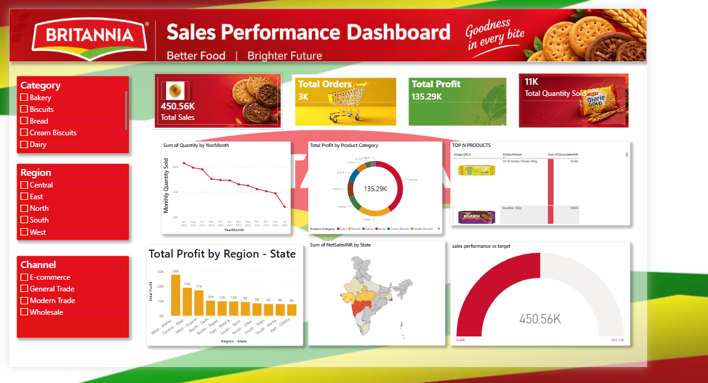

# Britannia FMCG Analytics Dashboard

An interactive Power BI analytics dashboard providing visibility into Britannia's retail sales performance, regional product demand, and channel profitability.

---

## 📊 Dashboard Overview

---

## 🔍 Key Business Insights
- *Revenue & Profit Tracking:* Analyzed sales across major product categories (Biscuits, Dairy, Bakery) to identify margin drivers.
- *Geographic Distribution:* Mapped state-wise and territory-level distribution channels to highlight high-growth vs. underperforming markets.
- *Retail Channel Efficiency:* Compared performance metrics across modern trade, general retail, and distributor channels.

---

## 🛠️ Technical Implementation
- *Data Modeling:* Built an optimized data model with clear table relationships and star-schema principles.
- *DAX Measures:* Developed calculated columns and dynamic measures for YoY sales variance, margins, and running totals.
- *Interactive UI:* Configured custom slicers, drill-through pages, and synchronized card visuals for quick metric evaluation.