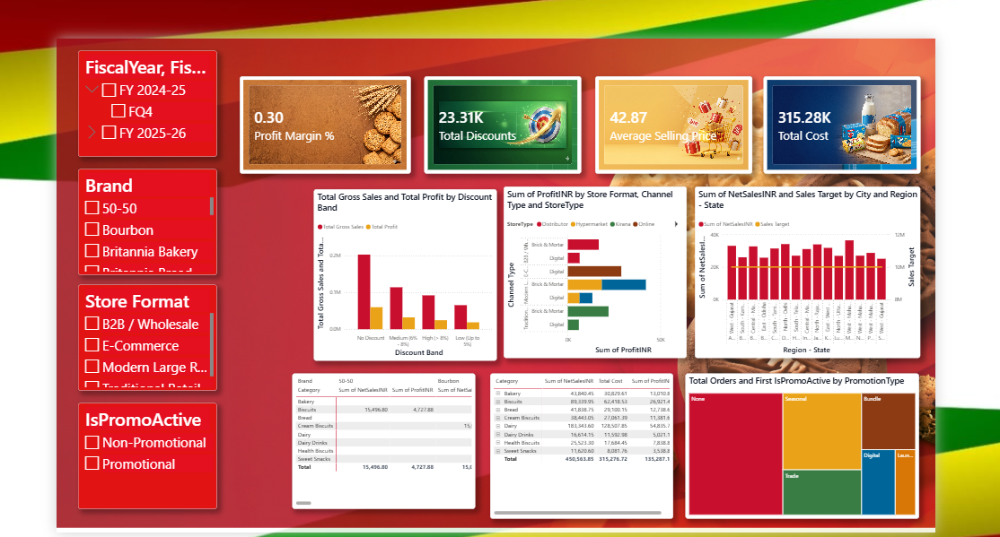

# Britannia FMCG Analytics Dashboard

An interactive Power BI analytics dashboard providing visibility into Britannia's retail sales performance, demand, and channel profitability.

----

# 🍪 Britannia Sales & Performance Analytics

An interactive Power BI business analytics solution built to analyze sales volumes, profitability drivers, channel dynamics, and promotional efficiency across regions and product categories.

---

## 📊 Dashboard 1: Sales Performance Overview
Focuses on macro-level sales volume, revenue KPIs, monthly trends, regional distribution, and target achievement tracking.

### Key Features & Metrics:
- *Core KPIs:* Total Sales (450.56K), Total Orders (3K), Total Profit (135.29K), and Total Quantity Sold (11K).
- *Trend Analysis:* Monthly quantity sold run-charts identifying seasonal peaks and supply fluctuations.
- *Category Profitability:* Donut chart breakdown assessing margin contributions across Bakery, Biscuits, Bread, Cream Biscuits, and Dairy.
- *Geographic Performance:* Regional choropleth and bar visualizations highlighting state-level revenue and target progress gauges.
- *Dynamic Slicers:* Interactive filtering by Category, Region, and Channel.

---

## 🔍 Dashboard 2: Profitability & Pricing Insights
Focuses on granular profitability drivers, discount elasticity, retail store formats, and promotional campaign effectiveness.

### Key Features & Metrics:
- *Financial KPIs:* Profit Margin % (0.30), Total Discounts (23.31K), Average Selling Price (42.87), and Total Cost (315.28K).
- *Discount vs. Profit Analysis:* Multi-metric bar visual comparing Total Gross Sales against Net Profit across discount bands.
- *Channel & Format Matrix:* Profitability mapping across Modern Large Retail, Traditional Retail, E-Commerce, and B2B Wholesale.
- *Promotion Diagnostics:* Treemap visualization evaluating order volumes and revenue generated during active promotional vs. non-promotional periods.
- *Detailed Audit Grid:* Product-level breakdown comparing Net Sales, Cost, and Profit margins.

---

## 💡 Key Business Insights

- *Category Contribution:* High-margin product lines such as Cream Biscuits and Dairy consistently deliver higher unit profitability compared to high-volume standard lines.
- *Discount Band Sensitivity:* Beyond a threshold discount band, incremental gross volume fails to offset margin compression, pinpointing opportunities for pricing optimization.
- *Channel Variance:* Modern trade and organized retail formats show higher basket sizes, while traditional retail drives broad regional reach.
- *Promotional Lift:* Targeted promotional periods generate significant order spikes, with distinct performance variations across urban versus rural distribution zones.

---

## 🛠️ Technical Implementation

- *Data Modeling:* Optimized star-schema data model with established one-to-many relationships connecting centralized Fact Sales to normalized Dimension tables (Calendar, Products, Geography, Channels).
- *DAX Calculations:* Custom measures developed for dynamic aggregation, Profit Margin %, YoY variance, dynamic target tracking, and pricing band segmentations.
- *Interactive UI/UX:* Built with synchronized custom slicers, consistent color branding, custom visual cards, and optimized layout hierarchy for executive consumption.

